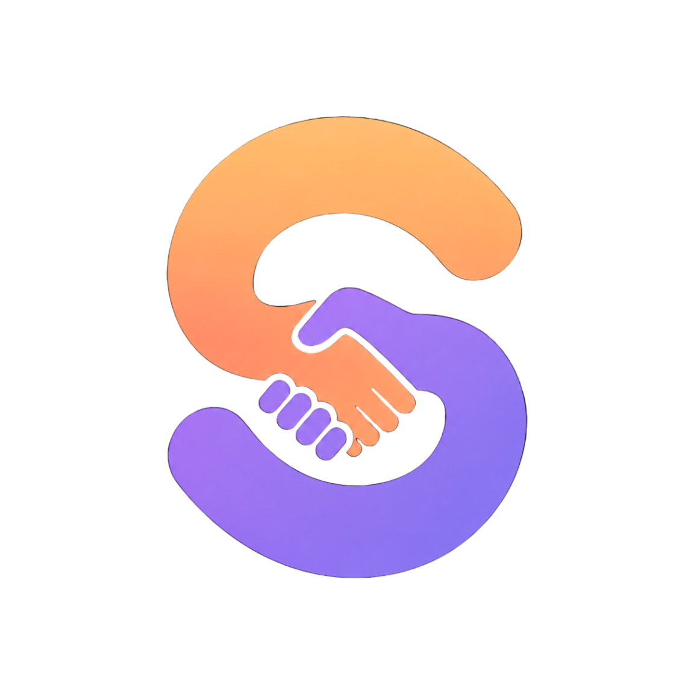
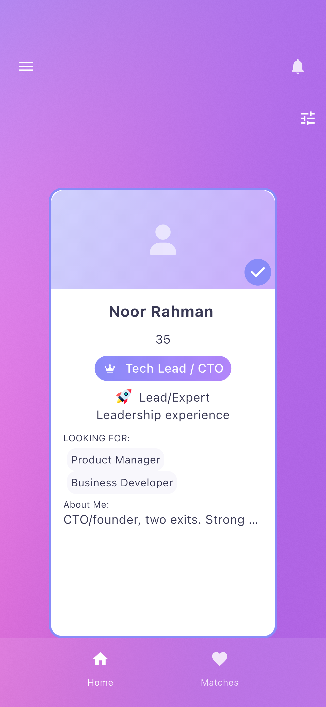
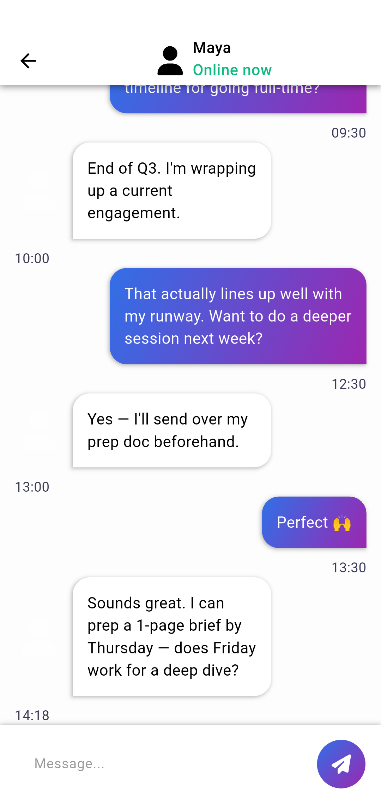
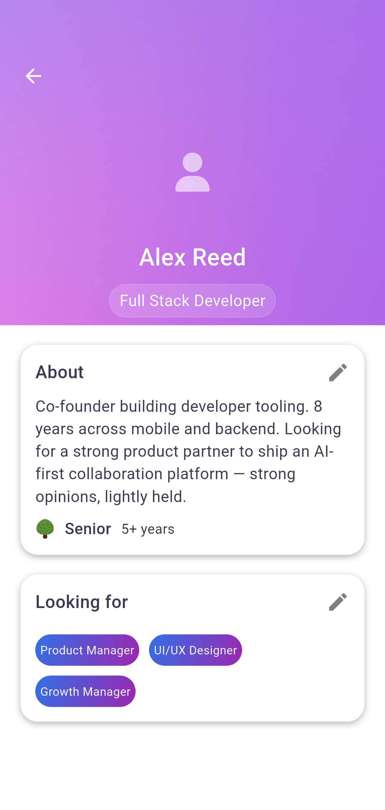
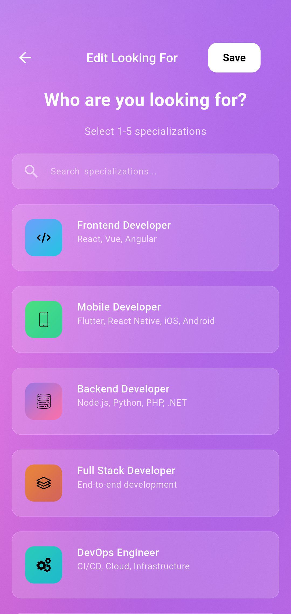
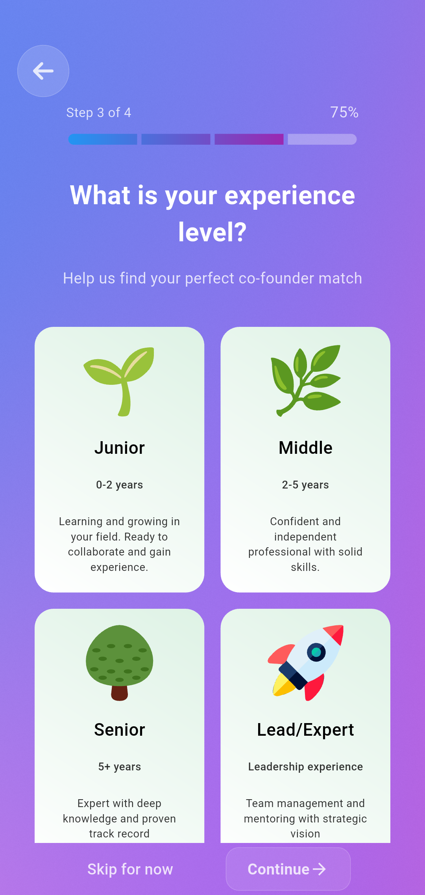
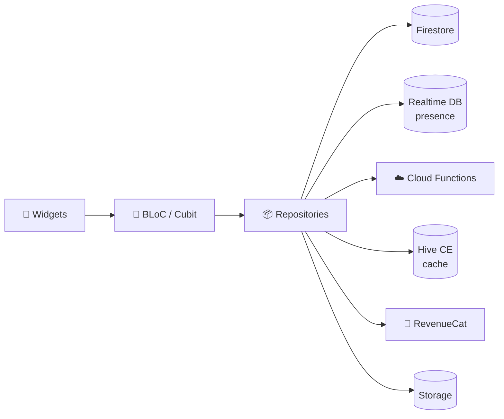

<div align="center">



# Synergy Hub

### Find your co-founder. Swipe, match, build.

A production matchmaking app for founders. It connects people with complementary skills, roles and goals so they can start a company together.

<a href="https://apps.apple.com/us/app/synergy-hub/id6767223876"></a>

<br/><br/>


</div>

---

## 📱 Screenshots

<table>
  <tr>
    <td align="center"><br/><sub><b>Discovery</b></sub></td>
    <td align="center"><br/><sub><b>Matches</b></sub></td>
    <td align="center"><br/><sub><b>Profile</b></sub></td>
    <td align="center"><br/><sub><b>Looking for</b></sub></td>
    <td align="center"><br/><sub><b>Onboarding survey</b></sub></td>
  </tr>
</table>

---

## ✨ Features

| | Feature | Details |
|---|---|---|
| 🔥 | **Swipe discovery** | Card deck with filters and a local cache for fast, smooth swiping |
| 💘 | **Liked you** | See who already liked your profile |
| 🤝 | **Mutual matches** | Animated match result screen and a matches list |
| 💬 | **Real-time chat** | Firestore-backed conversations, Hive cache, online presence via Realtime DB |
| 🧭 | **Onboarding survey** | Role, specialization, experience and goal, used to build the match profile |
| 📍 | **Nearby founders** | GPS location with distance ranking computed in Cloud Functions |
| 🔐 | **Sign-in options** | Email/password, Google and Sign in with Apple |
| 💎 | **Premium** | RevenueCat subscriptions, a paywall sheet and custom background palettes |
| 🔔 | **Push notifications** | FCM on mobile and web, plus local notifications and per-user settings |
| 📶 | **Offline mode** | Connectivity banner and a dedicated offline page |
| 🛡️ | **Safety** | Report users directly from their profile |

---

## 🛠 Tech Stack

| Layer | Technologies |
|---|---|
| **UI** | Flutter · 5 custom **GLSL fragment shaders** (animated gradients, pulse effects) · Lottie · `responsive_framework` (mobile → 4K web) · `flutter_svg` · `cached_network_image` |
| **State** | `flutter_bloc` / Cubit · `freezed` immutable states · `bloc_concurrency` event transformers · `rxdart` |
| **Navigation** | `go_router` + `go_router_builder` (type-safe routes) |
| **DI** | `get_it` with a module per feature |
| **Local storage** | Hive CE (typed adapters) · `shared_preferences` |
| **Backend** | Firebase **Auth · Firestore · Cloud Functions · Realtime DB · Storage · Messaging · Crashlytics** |
| **Monetization** | RevenueCat (`purchases_flutter`) |
| **Codegen** | `build_runner` · `json_serializable` · `flutter_gen` |
| **Testing** | `bloc_test` · `mocktail` · `integration_test` (automated store screenshots) |
| **CI/CD** | Codemagic (TestFlight, Play internal track, Firebase Hosting) · fastlane (App Store metadata & screenshots) |

---

## 🏗 Architecture

Feature-first **clean architecture**. Each feature has its own `data` / `domain` / `presentation` / `di` layers, and shared code lives in `lib/core`.



```
lib/
├── core/            # DI, routing, theme, resources, l10n, Hive, services
├── features/
│   ├── auth/            ├── matches/        ├── chat/
│   ├── onboard_survey/  ├── user/           ├── subscription/
│   ├── appearance/      ├── notifications/  ├── report/
│   ├── connectivity/    ├── home/           └── settings · support · legal
├── firebase/        # Flavor-specific FirebaseOptions
└── main.dart
shaders/             # GLSL fragment shaders
docs/                # Backend (Cloud Functions) API contracts
tool/                # Build, configure and screenshot scripts
```

The Cloud Functions live in a separate repository. Their API contracts are in [`docs/`](docs/).

---

## 🚀 Getting Started

### Prerequisites

- Flutter **3.41.x** (Dart ^3.12)
- [FlutterFire CLI](https://firebase.google.com/docs/flutter/setup) and the Firebase CLI
- `gcloud` CLI (for Storage CORS)
- Xcode / Android Studio

### 1. Install dependencies and generate code

```shell
flutter pub get
dart run build_runner build -d
```

### 2. Environment variables

Copy the template and fill in the values:

```shell
cp .env.example .env
```

```dotenv
# Google Sign-In (web/server OAuth client ID)
DEV_SERVER_CLIENT_ID=<dev-client-id>.apps.googleusercontent.com
PROD_SERVER_CLIENT_ID=<prod-client-id>.apps.googleusercontent.com

# Firebase Cloud Messaging — Web Push (VAPID) key
DEV_FIREBASE_WEB_PUSH_CERTIFICATE=<dev-vapid-key>
PROD_FIREBASE_WEB_PUSH_CERTIFICATE=<prod-vapid-key>

# RevenueCat public SDK keys
DEV_REVENUECAT_APPLE_API_KEY=appl_<...>
DEV_REVENUECAT_GOOGLE_API_KEY=goog_<...>
PROD_REVENUECAT_APPLE_API_KEY=appl_<...>
PROD_REVENUECAT_GOOGLE_API_KEY=goog_<...>

# Firebase Hosting URL
FIREBASE_PROJECT_WEB_URL=<project>.web.app
```

| Variable | Purpose | Where to find it |
|---|---|---|
| `DEV_/PROD_SERVER_CLIENT_ID` | Google Sign-In server client ID. Also injected into `web/index.html` | `firebase.json` / GCP → APIs & Services → Credentials |
| `DEV_/PROD_FIREBASE_WEB_PUSH_CERTIFICATE` | FCM web push key | Firebase → Project Settings → Cloud Messaging → *Web Push certificates* (bottom of page) |
| `DEV_/PROD_REVENUECAT_APPLE_API_KEY` | RevenueCat iOS key *(optional, defaults to empty; needed for subscriptions)* | RevenueCat → Project → API keys |
| `DEV_/PROD_REVENUECAT_GOOGLE_API_KEY` | RevenueCat Android key *(optional)* | RevenueCat → Project → API keys |
| `FIREBASE_PROJECT_WEB_URL` | Firebase Hosting domain | Firebase → Hosting |
| `DARTENV` *(dart-define)* | Selects the flavor: `development` or `prod` (default `prod`) | Passed at build time |

> [!NOTE]
> **iOS / Android** read `.env`, which is bundled as an asset through `flutter_dotenv`.
> **Web** does not bundle `.env`; the same keys are passed with `--dart-define`.

> [!CAUTION]
> Never commit `.env` or paste real key values into docs or scripts.

### 3. Firebase

Two Firebase projects are used:

| Flavor | Firebase project | Bundle / application ID |
|---|---|---|
| `development` | `synergyhub-a3e1b` | `com.hengell.synergyhub.dev` |
| `prod` | `sinergyhub-prod` | `com.hengell.synergyhub` |

Generate the options for both projects:

```shell
bash tool/configure.sh
```

Make sure each flavor's service files are in place:

```
ios/Runner/flavors/development/GoogleService-Info.plist
ios/Runner/flavors/production/GoogleService-Info.plist
android/app/src/development/google-services.json
android/app/src/prod/google-services.json
```

### 4. SHA fingerprints (Google Sign-In on Android)

Register both the debug and release fingerprints in Firebase:

```shell
cd android && ./gradlew signingReport && cd ..
```

### 5. Storage CORS (web)

```shell
gcloud storage buckets update gs://synergyhub-a3e1b.firebasestorage.app --cors-file=cors.json
```

### 6. Sign in with Apple

 

| Platform | How it works in the app | What it needs |
|---|---|---|
| 🍎 iOS | Native `SignInWithApple.getAppleIDCredential` → Firebase `OAuthProvider('apple.com')` | App ID capability + entitlement |
| 🤖 Android | Firebase `signInWithProvider(AppleAuthProvider())` (web OAuth flow) | Services ID + private key + return URL |

<details>
<summary><b>Setup checklist</b></summary>

1. **Apple Developer → Identifiers → App ID** (`com.hengell.synergyhub` and `.dev`): enable **Sign in with Apple**. Regenerate the provisioning profiles.
2. **Xcode → Runner → Signing & Capabilities**: add **Sign in with Apple**. This is already in `ios/Runner/Runner.entitlements`.
3. **Apple Developer → Identifiers → Services IDs** (needed for Android): create one, enable Sign in with Apple, and set:
   - Domain: `<firebase-project>.firebaseapp.com`
   - Return URL: `https://<firebase-project>.firebaseapp.com/__/auth/handler`
4. **Apple Developer → Keys**: create a key with **Sign in with Apple** enabled and download the `.p8`. You can only download it once.
5. **Firebase → Authentication → Sign-in method → Apple**: enable it and fill in the Services ID, Team ID, Key ID and `.p8` private key. Do this in **both** Firebase projects (dev and prod).

</details>

📖 Full walkthrough (iOS + Android): [Implement Sign in with Apple on iOS & Android using Flutter — complete guide](https://medium.com/@mhmd.abdelrazk/implement-sign-in-with-apple-on-ios-android-using-flutter-complete-guide-ff66e8db6d5a) · [`sign_in_with_apple` package docs](https://pub.dev/packages/sign_in_with_apple) · [Firebase: Apple on Android](https://firebase.google.com/docs/auth/android/apple)

### 7. Push notifications

 

| Platform | Transport | What it needs |
|---|---|---|
| 🍎 iOS | APNs → FCM | APNs auth key uploaded to Firebase + Push capability + background mode |
| 🤖 Android | FCM | `google-services.json` (nothing extra) |
| 🌐 Web | FCM Web Push | VAPID key (`*_FIREBASE_WEB_PUSH_CERTIFICATE`) + `web/firebase-messaging-sw.js` |

<details>
<summary><b>Setup checklist</b></summary>

1. **Apple Developer → Keys**: create an **APNs** key and download the `.p8`.
2. **Firebase → Project Settings → Cloud Messaging → Apple app configuration**: upload the APNs key with its Key ID and Team ID. Do this in **both** projects.
3. **Xcode → Signing & Capabilities**: add **Push Notifications**, and add **Background Modes** with *Remote notifications*. The `aps-environment` entitlement and `UIBackgroundModes` are already set.
4. **Web**: generate a key pair under *Web Push certificates* and put it in `.env` as `DEV_/PROD_FIREBASE_WEB_PUSH_CERTIFICATE`.
5. Test it from **Firebase → Messaging → Send test message** with the FCM token from the app log. On iOS, test on a real device or an Apple-silicon simulator (Xcode 14+).

</details>

📖 References: [FlutterFire Cloud Messaging setup](https://firebase.flutter.dev/docs/messaging/overview) · [Apple push notifications (APNs) for FCM](https://firebase.google.com/docs/cloud-messaging/ios/certs) · [Web Push / VAPID](https://firebase.google.com/docs/cloud-messaging/js/client)

### 8. Run

| Target | Command |
|---|---|
| 📱 Mobile, dev | `flutter run --flavor development --dart-define=DARTENV=development` |
| 📱 Mobile, prod | `flutter run --flavor prod --dart-define=DARTENV=prod` |
| 🌐 Web, dev | `cd tool && bash web_build_dev.sh` |
| 🌐 Web, prod | `cd tool && bash web_build_prod.sh` |

The web scripts copy `web/flavor/{dev,prod}` over `web/`, render `web/index.html` from `index.html.template` with the matching client ID, and start Chrome on `localhost:5000`.

---

## 📦 Build & Release

```shell
bash tool/build_android_aab_prod.sh   # Android App Bundle (prod)
bash tool/build_android_aab_dev.sh    # Android App Bundle (dev)
make                                  # Web release build (bumps build number)
```

### Codemagic workflows

| Workflow | What it does |
|---|---|
| `ios-workflow` | Runs tests → builds the prod IPA → uploads to **TestFlight** |
| `upload_to_internal_test_aab` | Restores and verifies the keystore → builds the prod AAB → **Google Play internal track** |
| `web-deploy` | Builds the web app → deploys to **Firebase Hosting** → Telegram notification |
| `upload_ios_metadata` | Validates `fastlane/metadata` → uploads App Store metadata and screenshots via **fastlane** |

<details>
<summary><b>CI secrets (Codemagic environment groups)</b></summary>

| Group | Variables |
|---|---|
| `env` | All `.env` keys listed above |
| `files` | `FIREBASE_JSON`, `FIREBASE_OPTIONS`, `FIREBASE_TOKEN` |
| `store_credentials` | `APPSTORE_P8`, `APPSTORE_KEY_ID`, `APPSTORE_ISSUER_ID`, `APPSTORE_APP_ID`, `APPSTORE_APP_NAME`, `IOS_BUNDLE_ID`, `GOOGLE_PLAY_SERVICE_ACCOUNT_CREDENTIALS`, `KEY_PROPERTY`, `UPLOAD_KEYSTORE_BASE64` |
| `purchase` | RevenueCat keys |
| `notifier` | `TELEGRAM_BOT_TOKEN`, `TELEGRAM_CHAT_ID` |
| fastlane `Appfile` | `APPLE_DEVELOPER_EMAIL`, `APPLE_CONNECT_EMAIL`, `APPLE_TEAM_ID` |

</details>

---

## 🧪 Testing

```shell
flutter test
```

Unit and BLoC tests (`bloc_test` + `mocktail`) cover `core/`, `features/` and `firebase/`.

### Automated store screenshots

`integration_test/screenshots_test.dart` walks through every screen with mocked data and captures App Store–sized PNGs (1284×2778):

```shell
flutter test integration_test/screenshots_test.dart \
  -d <ios-simulator-id> \
  --flavor=development \
  --dart-define=DARTENV=development \
  --dart-define=DEV_FIREBASE_WEB_PUSH_CERTIFICATE=<dev-vapid-key> \
  --dart-define=DEV_SERVER_CLIENT_ID=<dev-client-id>.apps.googleusercontent.com \
  --dart-define=FIREBASE_PROJECT_WEB_URL=<project>.web.app
```

Or use `tool/flutter_screenshot_maker.sh`. The output goes to `tool/outputs/screenshots/`.

---

<div align="center">

[Privacy Policy](assets/data/privacy_policy.md) · [Terms of Use](assets/data/terms_of_use.md) · [Support](assets/data/support.md)

<sub>Built with 💙 Flutter & 🔥 Firebase</sub>

</div>
